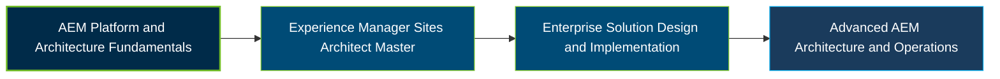

# Adobe Experience Manager Sites Architect Master Certification Exam Guide

A dedicated, comprehensive study guide and architectural reference repository for candidates preparing for the **Adobe Experience Manager Sites Architect Master Certification Exam (AD0-E117)**.

---

## Exam Overview

The Adobe Experience Manager Sites Architect Master certification validates advanced expertise in designing, implementing, and maintaining enterprise-level AEM Sites architectures that meet complex business and technical requirements.

- **Exam Format**: Online proctored certification exam.
- **Target Audience**: AEM Architects, Lead Developers, Technical Architects, Solution Architects, and DevOps Lead Engineers.
- **Prerequisites**: No formal prerequisite is stated on the public exam listing; the certification is intended for experienced AEM architecture professionals.

---

## Core Exam Domains & Knowledge Areas

### 1. Discovery

- Translate business goals into functional requirements.
- Assess existing architecture and identify technical constraints.
- Determine non-functional requirements for solution design.

### 2. Solution Design

- Design detailed AEM architectures based on business and technical requirements.
- Plan security, integrations, performance, and testing strategies.
- Design scalable, resilient solutions and recommend migration approaches.

### 3. Implementation

- Identify and resolve architecture and design issues during implementation.
- Recommend implementation approaches that align with solution requirements.
- Select appropriate methods for prototyping and proof-of-concept development.

### 4. Maintenance

- Diagnose and resolve issues encountered in production environments.
- Plan for new features, platform upgrades, and ongoing maintenance.
- Optimize solutions to meet non-functional requirements.

---

## Certification Path

*Suggested professional learning progression, not an official Adobe prerequisite or successor certification pathway.*

---

## Recommended Practice & Study Resources

To prepare effectively, combine Adobe's official certification materials with practical AEM architecture, implementation, and maintenance experience:

- **CertsGate**: Explore [Adobe AD0-E117 preparation resources](https://certsgate.com/exams/adobe/ad0-e117) for supplementary exam practice and study materials.
- **Adobe Experience Manager Documentation**: Use the [Adobe Experience Manager documentation](https://experienceleague.adobe.com/en/docs/experience-manager) to study AEM architecture, content modeling, integrations, deployment, security, and platform maintenance.
